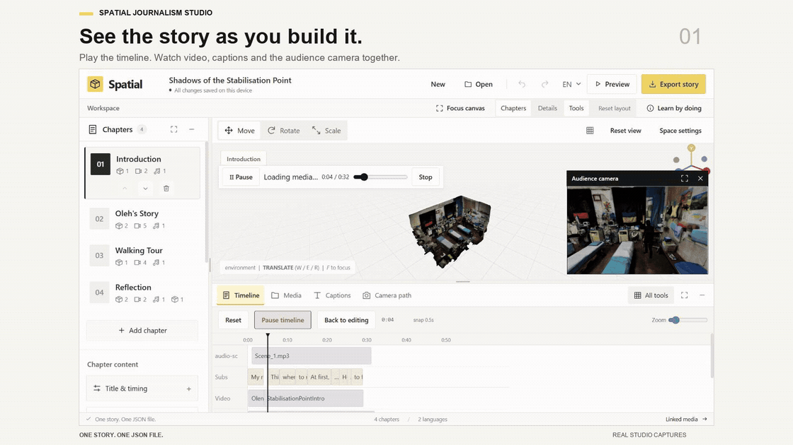
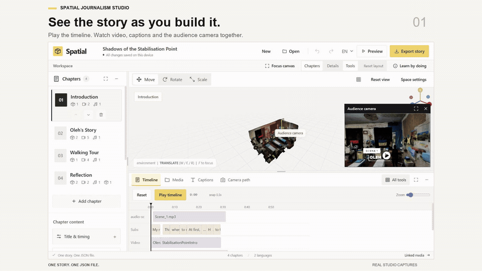
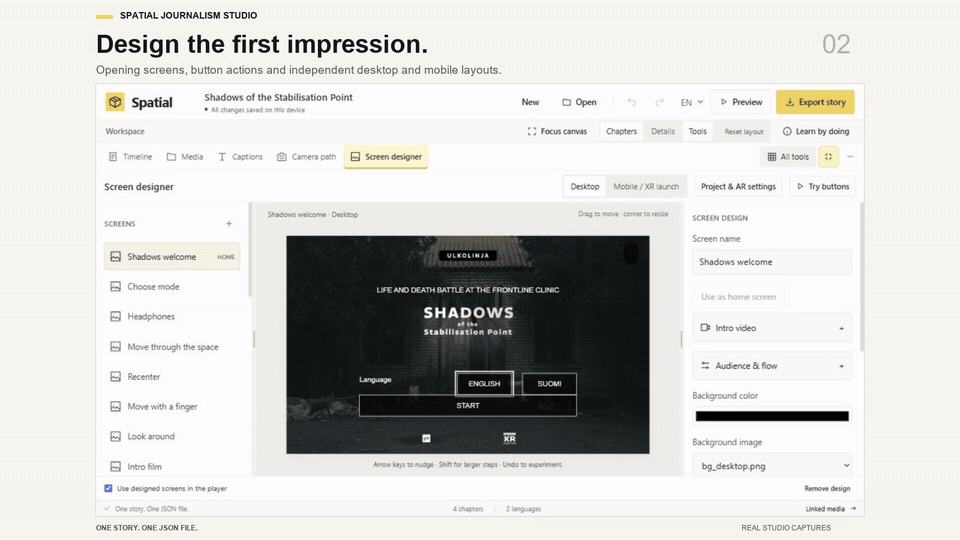
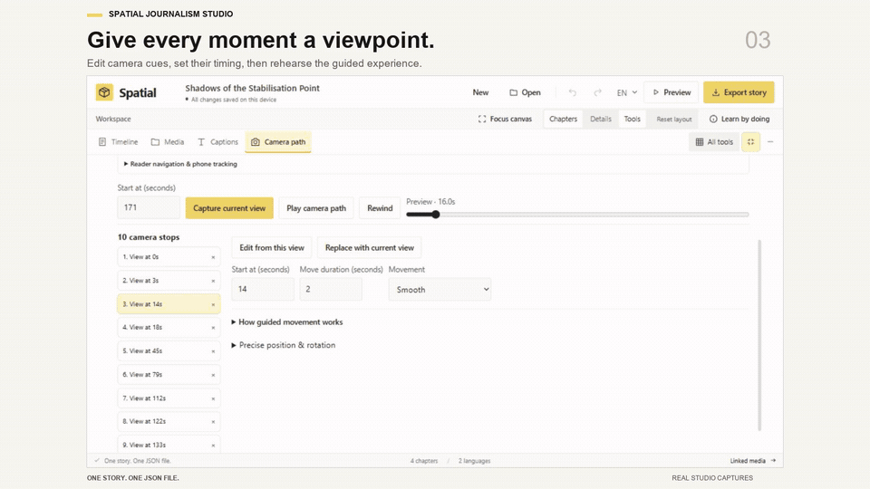
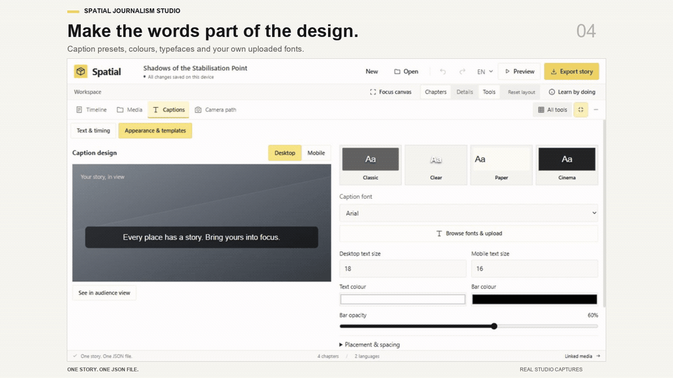
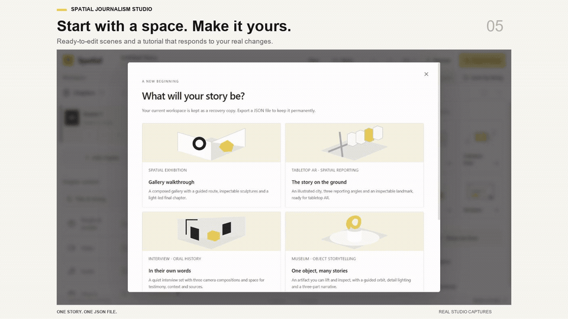
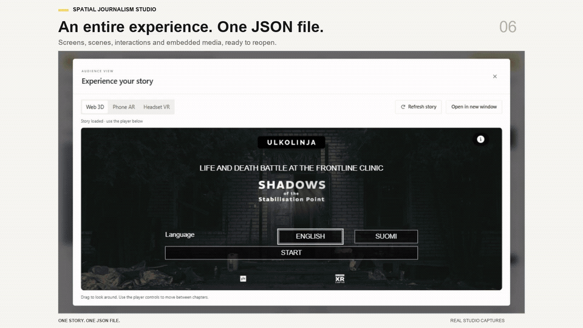

# Spatial Journalism Studio

**Build immersive stories visually. Keep the whole experience in one JSON file.**

Arrange a space, give it a voice, guide the reader and design the journey from the first screen to the final scene. Export the chapters, media, fonts, screens and interactions together, then reopen the same document to keep creating.

[](docs/media/studio-overview.mp4)

**[Watch the overview in full quality](docs/media/studio-overview.mp4)** · [Start locally](#start-locally) · [Studio guide](docs/studio-guide.md) · [Story format](docs/studio-guide.md#story-contract)

## See what you can make

These are captures of the running studio and its Web 3D player. Click a preview for the full-quality, silent MP4.

| **Play while you create** | **Design the opening** |
| :--- | :--- |
| [](docs/media/01-live-playback.mp4) | [](docs/media/02-screen-designer.mp4) |
| Rehearse the chapter in the timeline. Expand the audience camera to see what your reader sees. | Compose welcome screens, video intros and buttons. Arrange desktop and mobile layouts independently. |
| **Guide the reader’s eye** | **Make the typography yours** |
| [](docs/media/03-guided-camera.mp4) | [](docs/media/04-caption-design.mp4) |
| Capture viewpoints, choose timing and easing, and play the route. Let readers choose Guided or Explore. | Start with caption presets, adjust the bar and text, choose a library font or upload your own. |
| **Start with something tangible** | **Take the entire story with you** |
| [](docs/media/05-start-create.mp4) | [](docs/media/06-portable-story.mp4) |
| Choose a gallery, tabletop city, interview or object story. Learn by making real changes in the editor. | Export one JSON with the experience and its media inside. Share it, reopen it and continue editing. |

[All videos, still previews and capture details](docs/media/README.md)

## One story. One JSON file.

The document contains the **chapters, 3D scene, camera paths, audio, video, captions, screen designs, buttons, fonts and interaction settings**. Referenced media is embedded during export. No separate media folder is required to reopen a portable story.

The editor checks the story before export and identifies missing media. Older stories remain importable. Large video files make larger JSON documents, so compress media for the devices you want to reach.

[Explore the story contract](docs/studio-guide.md#story-contract) · [Open a small self-contained example](examples/gallery/story.json)

## Start locally

Use Node.js 22. From the repository directory:

```powershell
npm ci
npm --prefix creator ci
npm run build:studio
npm run studio
```

Open **http://127.0.0.1:3000**. Choose **New** for a starter or **Open** for a story JSON. The studio includes the player.

For the documentary shown above, choose **New → Shadows of the Stabilisation Point**. Its source is [examples/shadows-rebuilt/story.json](examples/shadows-rebuilt/story.json). This local starter connects its media folder; **Export story** creates the portable version.

## Build for the browser

The player supports **Web 3D, phone AR and headset VR**. AR and VR require compatible hardware, browser support and HTTPS. Physical phone/headset verification remains in progress. The videos above demonstrate desktop Web 3D and authoring, not device tracking.

Deploy `creator/dist/` for the studio and player, or `dist/` for the player alone. [Hosting, device requirements and tracking limitations](docs/studio-guide.md#share-and-play).

To publish an authored experience, use **Preview → Test on your phone → Connect Netlify**. Once the studio owner enables the connection, **Create test link** uploads the complete experience and generates a QR automatically. **Publish this tested version** is a separate action after testing on a phone. Website ZIP downloads, Netlify Drop and GitHub Pages remain available. [Phone testing and publishing walkthrough](docs/phone-testing-and-publishing.md) · [Enable the Netlify connection](docs/netlify-connection.md).

The engine code is MIT licensed. Bundled dependencies, tracking binaries, fonts and documentary assets retain their respective terms; the repository license does not grant additional rights to them. [Tracking license details](docs/studio-guide.md#devices-and-verification-limits).

## Documentation and development

- [Studio guide](docs/studio-guide.md): authoring, screen design, camera tours, captions, sound, export and hosting.
- [Shadows feature map](docs/shadows-feature-map.md): original documentary features and their authoring controls.
- [JSON schema](engine/schema/story.schema.json): the portable story structure.

```powershell
npm run test:all
npm run audit:story-contract
npm run build:studio
```
